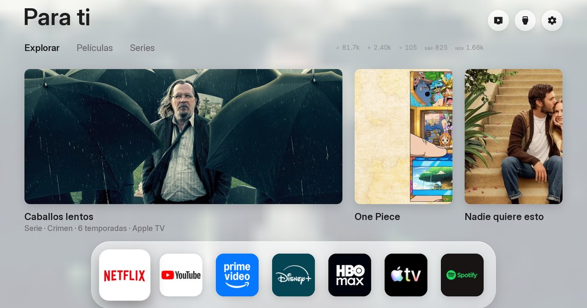

# FreeTV for your TV (web installer)

**Website: https://pharmajava.github.io/FREETVAPPWEB/**

[](https://pharmajava.github.io/FREETVAPPWEB/)

A web page so that anyone, without knowing anything about computers, can put [FreeTV](https://github.com/PharmaJava/FreeTV) on their
LG or Samsung TV: a clean, ad-free home screen, free and open source. The page and the app are in **English and Spanish** (it picks the language
of the browser or the phone, and has a button to change it). [Versión en español ↓](#freetv-para-tu-tele-instalador-web)

You give someone the address and they choose how to do it:

- **With a Windows computer** (there is a Mac version too): they download `FreeTV-Windows.exe`, open it and it guides them in the
  browser to the end.
- **With an Android phone**: they download the FreeTV app and do everything from the phone.

Either way: they get the TV ready by following a checklist (LG or Samsung), pick their TV from a list (on LG they also type the code
shown on the TV) and press **Install**. No terminal, nothing else to install.

## What the page has

A landing page, then the installer:

- **Landing:** what FreeTV is (with a real photo from an LG OLED), twelve features, the real screenshots and videos (GIFs) of FreeTV taken straight from the FreeTV repository on GitHub (`docs/screens`, `docs/gifs`, `docs/screenshot.png`, so they are always the current ones), how it works in
  three steps, which TVs it works on and an FAQ. Everything is in `index.html` with its texts in `landing.js` (and the installer's in
  `i18n.js`), in both languages.
- **Installer:** four steps with a progress bar: *1 get the program or the app* (skipped when it is already open) → *2 get the TV
  ready* (two buttons, **LG** or **Samsung**, each with its own checklist) → *3 find your TV* → *4 city and services (on LG the
  passphrase; on 2023+ Samsungs, "Sign in with Samsung") → Install*. Other brands: a link in step 2.
- Opened from the computer program or from the Android app, the page shows **only the installer** (no landing page around it).
- If the page is opened on a device that cannot install (an iPhone, or the "other" device you chose), it says where to open it, with
  buttons to share or copy the link, and lets you **get the TV ready meanwhile**.

## How it works

A web page, for security, **cannot** talk to the TV (not to find it, not to open the SSH connection LG requires to install). So the page
is the front door and what talks to the TV is a program on the same device:

```
 Windows computer:  page ─▶ "Download FreeTV for Windows" ─▶ FreeTV-Windows.exe (127.0.0.1:47321) ──────▶ LG / Samsung TV
 Android phone:     page ─▶ "Download the app" ─▶ FreeTV app (the same page inside + the installer) ─────▶ LG / Samsung TV
 iPhone:            the page explains an Android phone or a computer is needed (Apple only allows apps from its App Store)
```

1. **The page** (`index.html`, `i18n.js`, `landing.js`, `app.js`, `style.css` and `img/` in the root, which is what GitHub Pages
   serves).
2. **The computer program** (`connector/`, in Node, packed as a single `.exe`): when opened it starts a small server for that computer
   only (`127.0.0.1:47321`). The GitHub page talks to it there; if the browser does not allow it, the program opens the same page
   itself. On Windows it has its own name, icon and version, and if something fails the window does not close by itself: it waits for
   Enter, with the message in Spanish and English.
3. **The Android app** (`android/`): shows **the same page** (inside the app) and, underneath, the installer (`android/core`, Java),
   which the page calls through a JavaScript bridge (`window.FreeTVAndroid`) with the same API as the computer program.

Both installers do what FreeTV's `install.sh` does:
- **find TVs** on the Wi-Fi (SSDP and the ports LG, Samsung and Android TVs open) and say whether Developer Mode and the Key Server are on,
- ask the TV's **Key Server** for the key and unlock it with the *passphrase* (in memory only),
- read the TV's apps (the TV shows a message: **Accept** with the remote),
- put your settings and your apps in FreeTV's package, install the Home button helper and FreeTV, and configure them,
- only if ticked: the app store from the TV itself (like `install.sh`'s last question).

On **Samsung** (Tizen, 2017 or newer) they do what FreeTV's `tizen/install.py` does, plus the signing Samsung's tools do:
- connect to the TV over **SDB** (port 26101; the TV must have this device's IP as *Host PC IP*: the page shows it),
- **sign** FreeTV with the person's settings: on 2017-2022 TVs (Tizen 3 to 6.5) with FreeTV's author certificate (issued by Tizen's
  developer CA) and Tizen's public distributor certificate (if the TV does not take the newer one, the older one); on **2023 and newer**
  (Tizen 7+) with a **Samsung certificate for that TV**: the person signs in to their Samsung account on Samsung's own page (the one
  Samsung's tools use), Samsung sends the browser back to `localhost:4794` with a token, the installer makes two keys and Samsung's
  certificate service signs them for the TV's DUID; the TV gets the *device profile* and the certificates are kept for the next update,
- install it (`vd_appinstall`; if the TV has a FreeTV signed with another certificate, it removes it and installs again) and open it,
- if ticked (on by default): **TizenBrew** from its own GitHub release (signed with the TV's certificate on 2023+), for YouTube AdFree and
  Twitch AdFree.

The installers explain problems in Spanish; the page has its own text for each known problem (by its code: `passphrase`,
`keyserver`, `pairing`…) in both languages. The installation steps are translated too. Only the technical "details" of the
installation stay in Spanish.

### Which TVs

| TV | On this site |
|---|---|
| **LG (webOS)** | Full automatic install |
| **Samsung (Tizen, 2017+)** | Automatic install, **experimental** (tested against a pretend Samsung TV, not yet a real one). 2023+ TVs: sign in with a Samsung account. Optional TizenBrew (YouTube AdFree, Twitch AdFree) |
| Android TV / Google TV | Detected, but not automatic: the app has to be built. Link to Free My TV and to the guide |

### Security and privacy

- The *passphrase* goes from the browser to the program (or from the page to the app, inside the phone) and from there to the TV. It is
  not stored anywhere.
- The computer program only listens on `127.0.0.1` (not on the network), only accepts requests from this page (`Origin` header
  checked, JSON only, `Host` checked against *DNS rebinding*) and only installs on LG TVs with the right *passphrase*.
- Samsung sign-in: the password is typed only on Samsung's page; the installer gets a token, used once to ask for the certificate.
  The Samsung certificates are kept on that computer (`%APPDATA%\\FreeTV`, `~/Library/Application Support/FreeTV` or `~/.config/freetv`)
  or inside the app, for updates.
- Nothing goes through any server of ours: there is none. The page only asks, besides, Open-Meteo's city search.
- Non-secret settings (city, services, language) are remembered in the browser for next time. The TMDB key and the *passphrase* are not.

## For whoever maintains this

### The page and the downloads

- **Page:** GitHub Pages serves the root of `main` (Settings → Pages → *Deploy from a branch*: `main`, `/ (root)`), at
  https://pharmajava.github.io/FREETVAPPWEB/. `.nojekyll` makes it be served as it is.
- **Downloads:** the **Build and publish** workflow (`.github/workflows/build.yml`) runs on every *push* to `main`, by hand, and **every
  6 hours**:
  - on the 6-hourly run, a first job looks at FreeTV's latest commit and **only builds if it differs** from the one the downloads on the
    release were built from (`freetv-version.txt` on the release). That is how a change in FreeTV reaches the downloads by itself.
    (GitHub pauses scheduled runs of a repository with no activity for 60 days: any push or a manual run starts them again.)
  - it builds FreeTV's packages from `PharmaJava/FreeTV` (branch in `FREETV_REF`), for LG and for Samsung (`tizen/build.py`), and takes
    Tizen's public certificates from Samsung's Tizen SDK downloads (`connector/scripts/samsung-certs.js`). FreeTV's Samsung author
    certificate is made once and kept on the `datos-compilacion` pre-release, so every build signs with the same one (TVs only
    update an app signed with the same author certificate),
  - tests the install against pretend TVs (LG and Samsung; the Samsung one checks every signature and certificate chain),
  - builds the Android app and the program for Windows, Mac and Linux; the **packed program** installs on the pretend TVs on Windows,
    Mac and Linux, and the **app** on an Android emulator (Android 9 and 14), installer and page,
  - uploads them to the **`descargas`** release, which is the one the page links to: `FreeTV-Windows.exe`, `FreeTV-Android.apk`,
    `FreeTV-Mac-AppleSilicon.zip`, `FreeTV-Mac-Intel.zip` and `FreeTV-Linux`. Files of earlier builds that are no longer made are deleted.
  - The run's summary says which FreeTV commit the downloads carry.
- To pick up a new FreeTV right now without changing anything here: **Actions → Build and publish → Run workflow**.
- To change a text: `landing.js` (the landing page) or `i18n.js` (the installer), in both languages (same keys).
- The pictures are not here: the page loads them from the FreeTV repository (`raw.githubusercontent.com/PharmaJava/FreeTV/main/docs/...`). Change them there. Only `img/hero.webp` is kept as a fallback for the top photo.

### The Android app

- It is installed outside Google Play (the APK from the page): Android asks for permission to install apps from that source and Play
  Protect warns. The page explains what to tap.
- Updates must be signed with the same key. The key is in `android/app/freetv-release.keystore` (password `freetv-android`), in plain
  sight: handy for a family app, but whoever copies it could sign an app that pretends to be this one. To use your own secret key, keep
  it in GitHub secrets and pass it in the variables `FREETV_KEYSTORE`, `FREETV_KEYSTORE_PASSWORD`, `FREETV_KEY_ALIAS` and
  `FREETV_KEY_PASSWORD` (`android/app/build.gradle`). Changing the key means uninstalling the app before installing the new one.

### Locally

```bash
cd connector
npm ci
bash scripts/build-bundle.sh ../../FreeTV   # builds FreeTV's packages (needs git, python3, node 20+)
npm test                                    # the whole install against pretend TVs (test/fake-tv.js, test/fake-samsung.js)
npm start                                   # the program, with the page at http://127.0.0.1:47321
node scripts/build-exe.js                   # this system's executable, in dist/ (on Windows: FreeTV-Windows.exe, with icon)
cd ../android
gradle :core:test                           # the app's installer, against the same pretend TV (needs Node)
gradle :app:assembleRelease                 # the APK (needs the Android SDK)
```

### Structure

| Path | What |
|---|---|
| `index.html`, `style.css`, `app.js`, `icon.svg` | The page (GitHub Pages, the Android app and the program use the same one) |
| `i18n.js` | The installer's texts, in Spanish and English |
| `landing.js` | The landing page's texts, in Spanish and English |
| `img/` | `hero.webp` (fallback for the top photo) and `og.jpg` (social cards). The screenshots and GIFs come from the FreeTV repository |
| `connector/src/main.js` | The computer program: API (`/api/hello`, `/api/scan`, `/api/check`, `/api/install`, `/api/job/<id>`) and the page |
| `connector/src/scan.js` | Finding TVs (SSDP and ports) |
| `connector/src/lg.js` | The LG install, step by step |
| `connector/src/samsung.js`, `samsung-cert.js` | The Samsung install, and the Samsung account sign-in and certificates (2023+ TVs) |
| `connector/src/sdb.js`, `tizen-sign.js`, `zip.js`, `der.js` | SDB, signing `.wgt` packages, zip files and certificate requests |
| `connector/src/ssh.js`, `ssap.js`, `ipk.js` | Developer Mode key and SSH, the TV's remote control service, and rewriting the `.ipk` package |
| `connector/scripts/` | `build-bundle.sh` (FreeTV's packages), `samsung-certs.js` (the certificates to sign for Samsung) and `build-exe.js` (executable; on Windows it sets name, icon and version) |
| `connector/assets/freetv.ico` | The Windows `.exe`'s icon |
| `connector/test/` | Pretend LG and Samsung TVs, a pretend Samsung certificate service, and tests (`e2e.js`: the packed program) |
| `android/core/` | The Android app's installer (Java): `Scanner`, `Ssh`, `Ssap` (with `WebSocketClient`), `Ipk`, `Installer`, `Api`; for Samsung `Sdb`, `Tizen`, `Der`, `SamsungCert`, `Samsung` |
| `android/app/` | The app: `MainActivity` shows the page and gives it the bridge to the installer |

## Known limits

- **Tested against pretend TVs**, with FreeTV's real packages: the packed program on Windows, Mac and Linux, the app on an Android
  emulator. **Not yet on a real LG or Samsung**, nor on a real phone. Try it on a TV before handing it to the family.
- **Samsung 2023+:** Samsung's sign-in and certificate service can only be tried with a real Samsung account and TV; here they are
  tested against a pretend service. Samsung may change them.
- **iPhone cannot install:** Apple only allows apps from the App Store (a paid developer account and its review). From an iPhone the
  page explains the steps, lets you get the TV ready and sends you to open it on a computer or an Android phone.
- The program is **not signed** (signing costs money): Windows shows "Windows protected your PC" (→ *More info → Run anyway*) and the
  Mac asks to open it with a right click or from *Privacy & Security*. The page explains it.
- The YouTube channel shortcuts in the *Custom* tab come **without cover pictures** (they are other people's logos and the packages
  are published here). They work the same.
- The screenshots and videos on the page are the real ones from FreeTV on an LG OLED (loaded from the FreeTV repository).
- The passphrase may be typed in capitals or small letters: the installers try both.
- Android TV / Google TV: only detected, and the page explains what to do.
- Samsung with TizenBrew: for TizenBrew to open its apps, *Host PC IP* must then be `127.0.0.1` (the page says so at the end); to
  update FreeTV later, put this device's IP back.

## Credits

[FreeTV](https://github.com/PharmaJava/FreeTV) (MIT), which uses [Free My TV](https://freemytv.io) and the helper from
[Razdva122/clean-your-tv-lg-webos](https://github.com/Razdva122/clean-your-tv-lg-webos) (MIT). Samsung signing after Samsung's webIDE-common-tizentv (Apache 2.0): see [NOTICE.md](NOTICE.md). Not affiliated with LG or Samsung.

---

# FreeTV para tu tele (instalador web)

**Web: https://pharmajava.github.io/FREETVAPPWEB/** · [English ↑](#freetv-for-your-tv-web-installer)

Una página web para que cualquiera, sin saber nada de ordenadores, ponga [FreeTV](https://github.com/PharmaJava/FreeTV) en su tele LG o Samsung.
En **español y en inglés** (la web elige sola según el idioma del navegador o del móvil, y tiene un botón para cambiarlo).

Le das la dirección de la web y eligen cómo hacerlo:

- **Con un ordenador Windows** (también hay versión para Mac): descargan `FreeTV-Windows.exe`, lo abren y él les guía en el navegador
  hasta el final.
- **Con el móvil Android**: descargan la app FreeTV y lo hacen todo desde el móvil.

En los dos casos: preparan la tele siguiendo la lista (LG o Samsung), eligen su tele (en LG escriben además el código que sale en la
tele) y pulsan **Instalar**. Sin
terminal ni nada más que instalar.

## Qué tiene la página

Una página de presentación y, después, el instalador:

- **Presentación:** qué es FreeTV (con una foto real de una LG OLED), doce ventajas, las capturas y vídeos (GIF) reales de FreeTV tomados directamente del repositorio de FreeTV en GitHub (`docs/screens`, `docs/gifs`, `docs/screenshot.png`, así siempre son las actuales), cómo funciona
  en tres pasos, en qué teles funciona y unas preguntas frecuentes. Todo está en `index.html`, con sus textos en `landing.js` (y los
  del instalador en `i18n.js`), en los dos idiomas.
- **Instalador:** cuatro pasos con barra de progreso: *1 conseguir el programa o la app* (se salta si ya está abierto) → *2 preparar
  la tele* (dos botones, **LG** o **Samsung**, cada uno con su lista) → *3 encontrar tu tele* → *4 ciudad y servicios (en LG la
  passphrase; en Samsung de 2023 o más, «Iniciar sesión con Samsung») → Instalar*. Otras marcas: un enlace en el paso 2.
- Abierta desde el programa del ordenador o desde la app de Android, la página enseña **solo el instalador** (sin la presentación).
- Si la página se abre en un aparato que no puede instalar (un iPhone, o el «otro» aparato que elegiste), dice dónde abrirla, con
  botones para compartir o copiar el enlace, y deja **preparar la tele mientras tanto**.

## Cómo funciona

Una página web, por seguridad, **no puede** hablar con la tele (ni buscarla, ni abrir la conexión SSH que LG exige para instalar). Por
eso la web es la puerta de entrada y quien habla con la tele es un programa en el mismo aparato:

```
 ordenador Windows:  web ─▶ «Descargar FreeTV para Windows» ─▶ FreeTV-Windows.exe (127.0.0.1:47321) ──────▶ tele LG / Samsung
 móvil Android:      web ─▶ «Descargar la app» ─▶ app FreeTV (la misma web por dentro + el instalador) ─────▶ tele LG / Samsung
 iPhone:             la web explica que hace falta un Android o un ordenador (Apple solo deja instalar desde la App Store)
```

1. **La web** (`index.html`, `i18n.js`, `landing.js`, `app.js`, `style.css` e `img/` en la raíz, que es lo que sirve GitHub Pages). La portada pregunta
   «¿Con qué lo vas a hacer?» (ordenador Windows o móvil Android) y explica el camino entero, paso a paso. Luego da la descarga que
   toca. Si se elige un aparato distinto del que se está usando (o se entra desde un iPhone), dice en qué aparato abrir la web, con
   botones para compartir o copiar el enlace (en el móvil abre el menú de compartir: WhatsApp…), repite los pasos y deja **preparar
   la tele mientras tanto** desde ese mismo aparato (la lista del Modo Desarrollador). Al terminar la lista, dice dónde seguir. Todos
   los textos están en `i18n.js`, en español y en inglés.
2. **El programa para ordenador** (`connector/`, en Node, empaquetado como un solo `.exe`): al abrirlo arranca un pequeño servidor
   solo para ese ordenador (`127.0.0.1:47321`). La web de GitHub le habla ahí; si el navegador no la deja, el programa abre él mismo
   la misma web. En Windows lleva nombre, icono y versión propios, y si algo falla la ventana no se cierra sola: espera a que se pulse
   Enter, con el mensaje en español e inglés.
3. **La app de Android** (`android/`): muestra **la misma web** (va dentro de la app) y por debajo el instalador (`android/core`, Java),
   al que la web llama por un puente JavaScript (`window.FreeTVAndroid`) con la misma API que el programa del ordenador.

Los dos instaladores hacen lo mismo que `install.sh` de FreeTV:
- **buscan teles** en el wifi (SSDP y los puertos de LG, Samsung y Android TV) y dicen si el Modo Desarrollador y el Key Server están activos,
- piden la llave al **Key Server** de la tele y la abren con la *passphrase* (solo en memoria),
- leen las apps de la tele (la tele muestra un aviso: **Aceptar** con el mando),
- meten tus ajustes y tus apps en el paquete de FreeTV, instalan el ayudante del botón Home y FreeTV, y los configuran,
- solo si se marca: la tienda de apps desde la propia tele (igual que la pregunta final de `install.sh`).

En **Samsung** (Tizen, 2017 o más) hacen lo que hace `tizen/install.py` de FreeTV, más la firma que hacen las herramientas de Samsung:
- se conectan a la tele por **SDB** (puerto 26101; la tele tiene que tener la IP de este aparato como *Host PC IP*: la web la enseña),
- **firman** FreeTV con los ajustes de la persona: en teles de 2017 a 2022 (Tizen 3 a 6.5) con el certificado de autor de FreeTV (emitido
  por la CA de desarrolladores de Tizen) y el certificado público de distribuidor de Tizen (si la tele no acepta el nuevo, el antiguo); en
  las de **2023 o más** (Tizen 7+) con un **certificado de Samsung para esa tele**: la persona entra en su cuenta Samsung en la página de
  Samsung (la que usan sus herramientas), Samsung devuelve el navegador a `localhost:4794` con un token, el instalador hace dos claves y
  el servicio de certificados de Samsung las firma para el DUID de la tele; la tele recibe el *device profile* y los certificados se
  guardan para la próxima actualización,
- lo instalan (`vd_appinstall`; si la tele tiene un FreeTV firmado con otro certificado, lo quitan y lo vuelven a instalar) y lo abren,
- si se marca (viene marcado): **TizenBrew** desde su propia release de GitHub (firmado con el certificado de la tele en 2023+), para
  YouTube AdFree y Twitch AdFree.

Los instaladores explican los problemas en español; la web tiene su propio texto para cada problema conocido (por su código:
`passphrase`, `keyserver`, `pairing`…) en los dos idiomas. Los pasos de la instalación también se traducen en la web. Solo los
«detalles» técnicos de la instalación quedan en español.

### Qué teles

| Tele | En esta web |
|---|---|
| **LG (webOS)** | Instalación automática completa |
| **Samsung (Tizen, 2017+)** | Instalación automática, **experimental** (probada contra una Samsung simulada, todavía no en una de verdad). 2023 o más: entrar con una cuenta Samsung. TizenBrew opcional (YouTube AdFree, Twitch AdFree) |
| Android TV / Google TV | Se detecta, pero no es automático: hay que compilar la app. Enlace a Free My TV y a la guía |

### Seguridad y privacidad

- La *passphrase* va del navegador al programa (o de la web a la app, dentro del móvil) y de ahí a la tele. No se guarda en ningún sitio.
- El programa del ordenador solo escucha en `127.0.0.1` (no en la red), solo acepta peticiones de esta web (cabecera `Origin`
  comprobada, solo JSON, `Host` comprobado contra *DNS rebinding*) y solo instala en teles LG con la *passphrase* correcta.
- Sesión de Samsung: la contraseña solo se escribe en la página de Samsung; el instalador recibe un token y lo usa una vez para pedir el
  certificado. Los certificados de Samsung se guardan en ese ordenador (`%APPDATA%\\FreeTV`, `~/Library/Application Support/FreeTV` o
  `~/.config/freetv`) o dentro de la app, para las actualizaciones.
- Nada pasa por ningún servidor nuestro: no hay. La web solo consulta, además, el buscador de ciudades de Open-Meteo.
- Los ajustes no secretos (ciudad, servicios, idioma) se recuerdan en el navegador para la próxima vez. La clave de TMDB y la
  *passphrase*, no.

## Para quien mantiene esto

### La web y las descargas

- **Web:** GitHub Pages sirve la raíz de `main` (Settings → Pages → *Deploy from a branch*: `main`, `/ (root)`), en
  https://pharmajava.github.io/FREETVAPPWEB/. `.nojekyll` hace que se sirva tal cual.
- **Descargas:** el flujo **Build and publish** (`.github/workflows/build.yml`) se ejecuta en cada *push* a `main`, a mano y **cada
  6 horas**:
  - en la ejecución de cada 6 horas, un primer trabajo mira el último commit de FreeTV y **solo compila si es distinto** del que
    llevan las descargas de la *release* (`freetv-version.txt` en la *release*). Así un cambio en FreeTV llega solo a las descargas.
    (GitHub pausa las ejecuciones programadas de un repositorio sin actividad durante 60 días: cualquier *push* o una ejecución a mano
    las vuelve a poner en marcha.)
  - compila los paquetes de FreeTV desde `PharmaJava/FreeTV` (rama en `FREETV_REF`), para LG y para Samsung (`tizen/build.py`), y coge
    los certificados públicos de Tizen de las descargas del SDK de Tizen de Samsung (`connector/scripts/samsung-certs.js`). El
    certificado de autor de FreeTV para Samsung se hace una vez y se guarda en la *pre-release* `datos-compilacion`, para que cada
    compilación firme con el mismo (las teles solo actualizan una app firmada con el mismo certificado de autor),
  - prueba la instalación contra teles simuladas (LG y Samsung; la Samsung comprueba cada firma y cadena de certificados),
  - compila la app de Android y el programa para Windows, Mac y Linux; el **programa empaquetado** instala en las teles simuladas en
    Windows, Mac y Linux, y la **app** en un emulador de Android (Android 9 y 14), instalador y página,
  - los sube a la *release* **`descargas`**, que es la que enlaza la web: `FreeTV-Windows.exe`, `FreeTV-Android.apk`,
    `FreeTV-Mac-AppleSilicon.zip`, `FreeTV-Mac-Intel.zip` y `FreeTV-Linux`. Los archivos de versiones anteriores que ya no se hacen
    se borran.
  - El resumen de la ejecución dice qué commit de FreeTV llevan las descargas.
- Para meter una versión nueva de FreeTV ahora mismo sin cambiar nada aquí: **Actions → Build and publish → Run workflow**.
- Para cambiar un texto: `landing.js` (la presentación) o `i18n.js` (el instalador), en los dos idiomas (mismas claves).
- Las imágenes no están aquí: la web las carga del repositorio de FreeTV (`raw.githubusercontent.com/PharmaJava/FreeTV/main/docs/...`). Cámbialas allí. Solo `img/hero.webp` se guarda como respaldo de la foto de arriba.

### La app de Android

- Se instala fuera de Google Play (el APK de la web): Android pide permiso para instalar apps de esa fuente y Play Protect avisa. La web
  explica qué pulsar.
- Las actualizaciones deben ir firmadas con la misma clave. La clave está en `android/app/freetv-release.keystore` (contraseña
  `freetv-android`), a la vista: cómodo para una app familiar, pero quien la copie podría firmar una app que se haga pasar por esta.
  Para usar una clave propia y secreta, guárdala en secretos de GitHub y pásala en las variables `FREETV_KEYSTORE`,
  `FREETV_KEYSTORE_PASSWORD`, `FREETV_KEY_ALIAS` y `FREETV_KEY_PASSWORD` (`android/app/build.gradle`). Cambiar de clave obliga a
  desinstalar la app antes de instalar la nueva.

### En local

```bash
cd connector
npm ci
bash scripts/build-bundle.sh ../../FreeTV   # compila los paquetes de FreeTV (necesita git, python3, node 20+)
npm test                                    # instalación completa contra teles simuladas (test/fake-tv.js, test/fake-samsung.js)
npm start                                   # el programa, con la web en http://127.0.0.1:47321
node scripts/build-exe.js                   # el ejecutable de este sistema, en dist/ (en Windows: FreeTV-Windows.exe, con icono)
cd ../android
gradle :core:test                           # el instalador de la app, contra la misma tele simulada (necesita Node)
gradle :app:assembleRelease                 # el APK (necesita el SDK de Android)
```

### Estructura

| Ruta | Qué |
|---|---|
| `index.html`, `style.css`, `app.js`, `icon.svg` | La web (GitHub Pages, la app de Android y el programa usan la misma) |
| `i18n.js` | Los textos del instalador, en español e inglés |
| `landing.js` | Los textos de la presentación, en español e inglés |
| `img/` | `hero.webp` (respaldo de la foto de arriba) y `og.jpg` (tarjetas de redes sociales). Las capturas y los GIF vienen del repositorio de FreeTV |
| `connector/src/main.js` | El programa del ordenador: API (`/api/hello`, `/api/scan`, `/api/check`, `/api/install`, `/api/job/<id>`) y la web |
| `connector/src/scan.js` | Búsqueda de teles (SSDP y puertos) |
| `connector/src/lg.js` | La instalación en LG, paso a paso |
| `connector/src/samsung.js`, `samsung-cert.js` | La instalación en Samsung, y la sesión y los certificados de Samsung (teles 2023+) |
| `connector/src/sdb.js`, `tizen-sign.js`, `zip.js`, `der.js` | SDB, firma de paquetes `.wgt`, zip y solicitudes de certificado |
| `connector/src/ssh.js`, `ssap.js`, `ipk.js` | Llave y SSH del Modo Desarrollador, servicio del mando de la tele, y reescritura del paquete `.ipk` |
| `connector/scripts/` | `build-bundle.sh` (paquetes de FreeTV), `samsung-certs.js` (los certificados para firmar en Samsung) y `build-exe.js` (ejecutable; en Windows le pone nombre, icono y versión) |
| `connector/assets/freetv.ico` | El icono del `.exe` de Windows |
| `connector/test/` | Teles LG y Samsung simuladas, un servicio de certificados de Samsung simulado y pruebas (`e2e.js`: el programa empaquetado) |
| `android/core/` | El instalador de la app de Android (Java): `Scanner`, `Ssh`, `Ssap` (con `WebSocketClient`), `Ipk`, `Installer`, `Api`; para Samsung `Sdb`, `Tizen`, `Der`, `SamsungCert`, `Samsung` |
| `android/app/` | La app: `MainActivity` muestra la web y le da el puente al instalador |

## Límites conocidos

- **Probado contra teles simuladas**, con los paquetes reales de FreeTV: el programa empaquetado en Windows, Mac y Linux y la app en un
  emulador de Android. **Todavía no en una LG ni en una Samsung de verdad**, ni en un móvil de verdad. Conviene probarlo en una tele
  antes de dárselo a la familia.
- **Samsung 2023+:** la sesión y el servicio de certificados de Samsung solo se pueden probar con una cuenta y una tele Samsung de
  verdad; aquí se prueban contra un servicio simulado. Samsung puede cambiarlos.
- **iPhone no instala:** Apple solo deja instalar apps desde la App Store (cuenta de desarrollador de pago y su revisión). Desde un
  iPhone la web explica los pasos, deja preparar la tele y manda a abrirla en el ordenador o en un Android.
- El programa **no está firmado** (la firma cuesta dinero): Windows muestra «Windows protegió su PC» (→ *Más información → Ejecutar de
  todas formas*) y el Mac pide abrirlo con clic derecho o desde *Privacidad y seguridad*. La web lo explica.
- Los accesos directos a canales de YouTube de la pestaña *Personalizado* van **sin foto de portada** (son logos de otros y aquí se
  publican los paquetes). Funcionan igual.
- Las capturas y los vídeos de la página son los reales de FreeTV en una LG OLED (se cargan del repositorio de FreeTV).
- La passphrase se puede escribir en mayúsculas o minúsculas: los instaladores prueban las dos.
- Android TV / Google TV: solo se detectan y se explica qué hacer.
- Samsung con TizenBrew: para que TizenBrew abra sus apps, *Host PC IP* tiene que pasar a `127.0.0.1` (la web lo dice al final); para
  actualizar FreeTV más adelante, vuelve a poner la IP de este aparato.

## Créditos

[FreeTV](https://github.com/PharmaJava/FreeTV) (MIT), que usa [Free My TV](https://freemytv.io) y el ayudante de
[Razdva122/clean-your-tv-lg-webos](https://github.com/Razdva122/clean-your-tv-lg-webos) (MIT). La firma para Samsung sigue a webIDE-common-tizentv de Samsung (Apache 2.0): ver [NOTICE.md](NOTICE.md). No afiliado a LG ni a Samsung.
